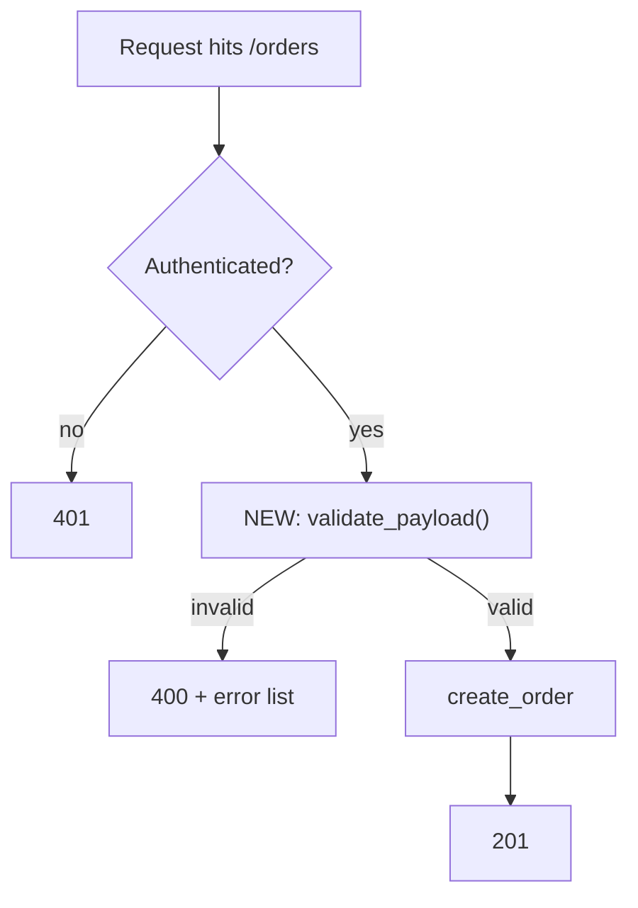

# Implementation Plan (/plan)

## Why this exists

Coding tasks almost always have hidden requirements: which files are actually in scope, what "done" means, what shouldn't change, how errors should be handled, what the user already tried. Writing code before those are pinned down produces work that has to be redone. This skill enforces a strict sequence: **investigate → clarify → propose → get explicit approval → execute.** No step is skipped, and no code changes happen before approval.

## Core principle: don't over-engineer

The best plan is the smallest one that fully meets the goal. Over-engineered plans cost the user review time, add code they have to maintain, and bury the actual change. Apply this to the plan **and** to the implementation.

- **Smallest change that works.** Prefer editing existing code over adding new files, layers, or modules.
- **Reuse what's there.** Use the project's existing patterns, helpers, and libraries before inventing new ones. Don't add a dependency for something a few lines can do.
- **No speculative extras.** No abstractions, interfaces, config options, feature flags, plugin points, or "we might need this later" generality unless the user asked for it or the task can't work without it.
- **No drive-by work.** Don't refactor, rename, reformat, or "clean up" code unrelated to the goal. If you spot something worth fixing, mention it in one line under _Not doing_ — don't add it to the plan.
- **Simple beats clever.** When two approaches both work, choose the one that's easier to read and review. Mention the heavier alternative only if there's a real reason someone might want it.
- **Every step earns its place.** For each step in the plan, ask: _would the goal fail without this?_ If not, cut it.
- **Scale to the task.** A one-line bug fix gets a few lines of plan, not a design doc. Never pad a plan to look thorough.

## Workflow

### Step 1 — Investigate before asking

Before asking the user anything, find out what you can yourself. If there's a codebase available (an attached repo, uploaded files, a connected project), read the relevant files, search for related code, and note the existing stack, patterns, and conventions. Anything you can determine this way becomes a stated assumption to confirm, not a question to ask — don't make the user re-explain things you can already see.

While investigating, look specifically for **what already exists that you can reuse** and **the current flow** of the code you'll change — you'll need both for the plan.

### Step 2 — Ask every necessary question, and don't stop early

This is the core discipline of the skill. Work through the checklist below. For each category, ask only what's genuinely still unresolved after your own investigation in Step 1 — skip anything already answered, already visible in the code, or clearly irrelevant to this task.

**Question checklist:**

- **Objective & success criteria** — What does "done" look like? How will the user check that it worked?
- **Scope boundaries** — What's explicitly in scope? What's explicitly out of scope / must not be touched?
- **Technical context** — Language/framework/stack, which files, modules, or services are involved. Confirm what you found in Step 1; ask about what you couldn't find.
- **Constraints** — Required or forbidden libraries/patterns, performance/security/compatibility requirements, style or lint conventions to follow.
- **Data & edge cases** — What inputs or states need handling, expected error-handling behavior, backward-compatibility requirements.
- **Testing & validation** — Expected test coverage, how the user wants to verify correctness, existing test conventions.
- **Dependencies & sequencing** — Does this depend on other in-flight work, external APIs, other people, or feature flags? Any required ordering?
- **Rollout considerations** — Migrations, feature flags, deploy steps, docs that need updating (skip for small internal changes where this is obviously irrelevant).

**How to ask:**

- Use an available interactive question tool for clarification questions instead of listing them in chat. In Default mode, use `request_user_input_async`; use `request_user_input` only when the active mode permits it. Offer concise choices when helpful and allow free-text answers. If no compatible interactive tool is available, ask in chat.
- Wait for answers before drafting parts of the plan that depend on them; continue independent read-only investigation while questions are pending. Silence or elapsed time is not an answer. Keep explicit plan approval separate and follow the tool's restrictions on permission requests.
- Ask in focused batches rather than one wall of text — a handful of questions at a time, grouped by theme, not fifteen at once.
- After each round of answers, re-check: did the answers introduce a new contradiction or open a new question (e.g. the user wants X, but that conflicts with the existing pattern you found in Step 1)? If so, ask a follow-up round.
- Keep going until you could write the plan without guessing at anything that would materially change it. A genuinely minor implementation detail with no real trade-off doesn't need a question — make the sensible default call and record it under **Assumptions** in the plan instead. But if guessing wrong would mean redoing a meaningful chunk of the plan, ask.
- Don't pad this for trivial requests. If the user invokes /plan for something genuinely small, a couple of quick questions (or none, if truly self-evident) is correct — the discipline scales with the size and risk of the change, not a fixed question count.

### Step 3 — Draft the plan

Use the structure below. Keep it concrete and scannable. Drop any section that adds nothing for this task (e.g. no Flow section for a change that doesn't alter any flow).

```
# Implementation Plan: [Title]

## Goal
[1-3 sentences: what this accomplishes and why]

## Scope
**In scope:** ...
**Out of scope:** ...
**Not doing (on purpose):** [extras you considered and left out to keep it simple]

## Approach
[The simplest strategy that meets the goal, 2-5 sentences — the "how", not just the "what".
Say what existing code/patterns you're reusing.]

## Flow
[Flowchart(s) — see "Visuals" below]

## Steps
1. [Concrete, ordered unit of work — reference real files/modules]
2. ...

## Code changes
[Per-file code blocks showing how the change will be made — see "Code blocks" below]

## Testing & validation
[How correctness will be verified — new tests, existing suite, manual checks]

## Risks & edge cases
[What could go wrong, tricky inputs, things to watch for]

## Assumptions
[Defaults you chose instead of asking about — small, low-stakes calls only]

## Open questions
[Should be empty. If it isn't, Step 2 isn't finished yet.]
```

#### Visuals: flowcharts

Add a flowchart when the change alters how control, data, or requests move through the code — it lets the user see the new behavior at a glance instead of reconstructing it from prose.

- **Show the change, not the whole system.** Chart only the part that's affected. Aim for roughly 10 nodes or fewer.
- **Before / after** when modifying an existing flow: one chart of the current flow, one of the new flow. Mark new or changed nodes clearly (e.g. a `NEW` / `CHANGED` label, or a distinct style).
- **New flow only** when building something that doesn't exist yet.
- **Skip it** for trivial changes (a typo, a constant, a one-line fix) where a chart would be bigger than the change.
- **Format:** use a Mermaid `flowchart` block by default. If the surface can't render Mermaid, use a simple ASCII diagram in a plain code block instead. Don't spend effort on styling.

Example (new flow, with the changed step marked):

````

````

#### Code blocks: show how the changes will be made

For each file that changes, show the actual shape of the change in a code block so the user can judge it before approving.

- **Modified code → `diff` block.** Show only the lines that change plus a few lines of context, with the file path above the block.
- **New file or function → normal language-tagged block.** Show the real signature and core logic; elide boilerplate with a `# ...` comment.
- **Show the new flow in code** when it helps: the key function or call sequence as it will look after the change.
- **Keep it a sketch, not the implementation.** Show enough to make the approach unambiguous. Don't write out every file in full, and note that final code may differ in small details.
- **Only what the plan needs.** The code blocks should match the Steps and the _Files_ touched — no extra helpers, types, or options that aren't in the plan.

Example:

````
**`api/orders.py`**
```diff
 def create(request):
+    errors = validate_payload(request.json)
+    if errors:
+        return {"errors": errors}, 400
     order = create_order(request.json)
     return order, 201
```

**`api/validation.py`** (new)
```python
def validate_payload(data: dict) -> list[str]:
    errors = []
    if not data.get("items"):
        errors.append("items is required")
    # ...
    return errors
```
````

These code blocks are **proposals shown in the chat**, not edits. Do not write them to any file until the plan is approved.

#### Simplicity check (do this before presenting)

Re-read the draft and ask:

1. Is there a smaller change that still meets the goal? If yes, use it.
2. Is every new file, class, function, option, or dependency strictly required? Cut what isn't.
3. Am I reusing existing code where I can?
4. Does every step trace directly back to the Goal?
5. Are the flowchart and code blocks showing only what's changing?

### Step 4 — Present for approval (hard gate)

Present the plan inline in the chat as text, including the flowcharts and code blocks. End with a direct, unambiguous approval request — for example: _"Does this plan look right? Reply **approved** to proceed, or tell me what to change."_

Then stop. Do not write, edit, or run any code in the same turn as presenting the plan — approval and execution are always separate turns.

- **Approved** (yes / approved / looks good / go ahead / ship it, etc.) → move to Step 5.
- **Changes requested** → revise the plan (update the flowcharts and code blocks too) and present the revised version with the same approval gate. Repeat as many times as needed — there's no cap on revision rounds. If the user asks for something simpler, take that seriously and actually cut scope rather than rephrasing.
- **New questions raised** → go back to Step 2 for those specific points, then re-present the plan.

Don't treat silence, a topic change, or a vague "ok" as approval. If it's not clearly a green light on the plan itself, ask for direct confirmation before touching any code.

### Step 5 — Execute

Once approved, implement the plan step by step, in the order laid out under **Steps**, matching the code blocks you showed. Give brief progress notes as you complete meaningful chunks of work — not after every line changed.

**Stay inside the plan.** Don't add features, abstractions, config, or cleanups that weren't approved, even if they seem like improvements. If you think something extra is genuinely needed, flag it and ask first.

If reality doesn't match the plan mid-implementation (a step turns out to be infeasible, a referenced file doesn't exist, an assumption was wrong, the simple approach turns out not to work), stop, explain what changed, and check with the user before continuing down a materially different path. Don't silently improvise something the user never approved.

## Scope of this skill

This skill is for coding and software work: features, refactors, bug fixes, migrations, architecture changes. It is not meant to turn every tiny fix into a ceremony — proportion the rigor of Steps 1-2, and the size of the plan and its visuals, to the size and risk of the change. For non-coding planning requests (e.g. project or event planning), use normal judgment instead of this template.
