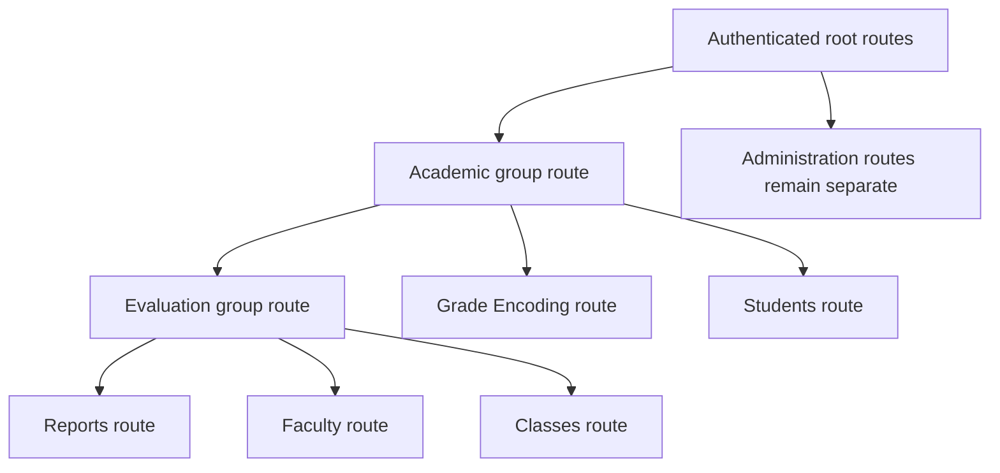

# Implementation Plan: Academic Route Hierarchy

## Goal

Make the route tree express the same hierarchy as the Academic feature folders. The Academic group owns its direct children, child paths inherit `/academic`, and each feature keeps its route definition in its own route module.

## Scope

**In scope:** Academic route composition, the nested Faculty Evaluation group, Students and Grade Encoding URLs, internal Students navigation, sidebar route derivation, route tests, and the relevant architecture/structure context notes.

**Out of scope:** Adding an Administration URL prefix, moving Academic Terms from the Administration menu or `/terms`, changing access rules, changing page/API behavior, or adding compatibility routes for root-level `/students` and `/grade-encoding`.

## Approach

Use `src/features/academic/academic.routes.tsx` as the sole `/academic` route parent. Compose its relative children from the Academic feature route modules. Give Faculty Evaluation its own group route under `evaluation/`, which composes reports, faculty, and classes. `SidebarNavigation` will put route configs directly into each menu group's `items` and render their hierarchy, so `hasEvaluation` and parallel arrays of flattened links are unnecessary.

## Proposed route structure

```text
Authenticated root
├── academic (`/academic`)
│   ├── index → Evaluation Reports
│   ├── evaluation (`/academic/evaluation`)
│   │   ├── evaluation-reports (`/academic/evaluation/evaluation-reports`)
│   │   ├── faculty (`/academic/evaluation/faculty`)
│   │   └── classes (`/academic/evaluation/classes`)
│   ├── grade-encoding (`/academic/grade-encoding`)
│   └── students (`/academic/students`)
├── terms (`/terms`, still in Administration)
├── audit-logs (`/audit-logs`)
├── users (`/users`)
└── auth routes
```

## Flow



## Steps

1. Create `features/academic/evaluation/evaluation.routes.tsx` as the `evaluation` parent and move the existing evaluation route aggregator out of the reports folder; rename the reports route module to `reports.routes.tsx` so each folder owns a clearly named route file.
2. Make `features/academic/academic.routes.tsx` the sole `academic` parent and compose its relative children from Evaluation, Grade Encoding, and Students. Keep the Academic index redirect to Evaluation Reports.
3. Register only `academicRoutes` at the authenticated root. Keep `administrationRoutes` separate so `/terms`, `/audit-logs`, and `/users` retain their current paths and menu placement.
4. Update `SidebarNavigation` so each menu group's `items` contains route configs directly. Render the Academic parent as the section root, render nested titled groups such as Evaluation as flyouts, and render sidebar-eligible feature routes as links. Keep Grade Encoding's existing custom access check.
5. Add/use a `STUDENTS_PATH` constant for `/academic/students`; update the Students page's open/close navigation and sidebar assertions. Do not add root-level aliases for `/students` or `/grade-encoding`.
6. Update the relevant architecture and structure context notes after implementation, then run focused route/sidebar/student/grade checks and the available type/lint/format checks.

## Code shape

**`src/features/academic/academic.routes.tsx`**

```tsx
export const academicRoutes = defineRoutes([
  {
    path: 'academic',
    element: <Outlet />,
    children: [
      { index: true, element: <Navigate to={EVALUATION_PATHS.reports} replace /> },
      ...evaluationRoutes,
      ...gradeEncodingRoutes,
      ...studentsRoutes,
    ],
  },
])
```

**`src/features/academic/evaluation/evaluation.routes.tsx`**

```tsx
export const evaluationRoutes = defineRoutes([
  {
    path: 'evaluation',
    element: <Outlet />,
    meta: { title: 'Faculty Evaluation', sidebar: false },
    children: [
      { index: true, element: <Navigate to={EVALUATION_PATHS.reports} replace /> },
      ...reportsRoutes,
      ...facultyRoutes,
      ...classesRoutes,
    ],
  },
])
```

**`src/components/SidebarNavigation.tsx`**

```tsx
const groups = [
  { title: 'Academic', items: [...academicRoutes] },
  { title: 'Administration', items: [...administrationRoutes] },
]
```

Here, `items` are `AppRouteConfig[]`. The sidebar renderer walks each route tree: it expands the Academic root into its children, treats the nested Evaluation group as a flyout when it has visible children, and turns eligible feature routes into links. This derives menu structure from route nesting instead of a separate `hasEvaluation` flag.

**`src/routes/index.tsx`**

```diff
-...academicFeatureRoutes,
+...academicRoutes,
 ...administrationRoutes,
```

**`src/routes/paths.ts` and `src/pages/Students.tsx`**

```ts
export const STUDENTS_PATH = '/academic/students'
// Use STUDENTS_PATH for opening a student record and closing back to the list.
```

The final code may differ slightly to preserve the existing route types and formatting.

## Files expected to change

- `src/features/academic/academic.routes.tsx`
- `src/features/academic/evaluation/evaluation.routes.tsx` (new group route)
- `src/features/academic/evaluation/reports/evaluation.routes.tsx` (rename to `reports.routes.tsx`)
- `src/routes/index.tsx`
- `src/routes/paths.ts`
- `src/components/SidebarNavigation.tsx`
- `src/pages/Students.tsx`
- `src/tests/routes/sidebar-navigation.test.tsx` and focused route tests as needed
- `.codex/context/architecture.md` and `.codex/context/structure.md`

Existing uncommitted work in these and adjacent files will be preserved and incorporated; no unrelated changes will be reverted.

## Testing & validation

- Update route/sidebar coverage for `/academic/students`, `/academic/grade-encoding`, nested Evaluation flyout links, direct feature links, and absence of `/students` and `/grade-encoding` sidebar links. Preserve the Grade Encoding visibility check for users without its custom route guard access.
- Run the focused student and grade route tests, type checking, and scoped lint/format checks. Report existing baseline failures separately.

## Risks & edge cases

- Moving `/students` and root-level `/grade-encoding` changes bookmark destinations; the requested behavior is to remove those paths without redirects.
- Sidebar route traversal must carry each route parent's path while descending; otherwise nested links will have incorrect URLs.
- Route access guards, existing Evaluation child paths, and the `/academic` index redirect must remain unchanged in behavior.

## Assumptions

- The hierarchy applies only to Academic. Administration routes keep their current root URLs and sidebar placement.
- Academic Terms remains at `/terms` under Administration.
- The current sidebar presentation remains: direct Students and Grade Encoding links, plus the Faculty Evaluation flyout.

## Open questions

None.
