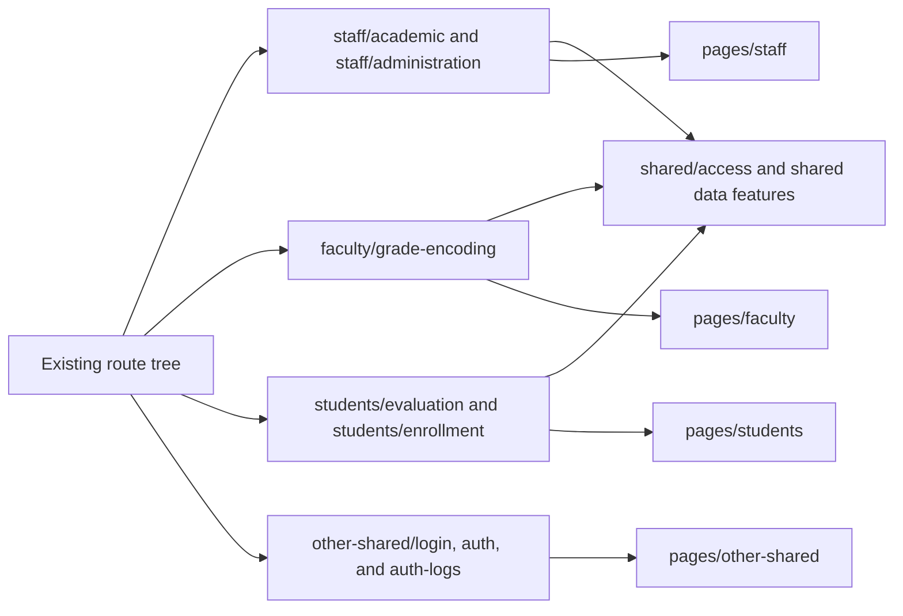

# Implementation Plan: Page Portal Regrouping Follow-up

## Goal

Complete the portal grouping by moving the 34 files in `src/pages` to match the already-regrouped features. Preserve route paths, access rules, and page behavior.

## Scope

**In scope:** Move page files, update their aliases and relative imports in features/routes/tests, update affected README references, and refresh the structure/architecture context notes.

**Out of scope:** Further feature moves, changing route URLs or access behavior, creating portal route prefixes from folder names, or adding an empty `other` folder.

## Existing feature groups

| Current | Destination |
| --- | --- |
| `features/academic/grade-encoding` | `features/faculty/grade-encoding` |
| `features/student-evaluation` | `features/students/evaluation` |
| `features/academic/enrollment/self-enrollment.*` | `features/students/enrollment/` |
| Remaining `features/academic` modules | `features/staff/academic/` |
| `features/administration` except audit logs | `features/staff/administration/` |
| `features/administration/audit-logs` | `features/other-shared/auth-logs/` |
| `features/auth`, `features/login` | `features/other-shared/auth/`, `features/other-shared/login/` |
| `features/administration/users/users-access.config.ts` | `features/shared/access/users-access.config.ts` |
| Existing `features/shared/*` | Keep under `features/shared/` |

| Current page path | Destination |
| --- | --- |
| `pages/grade-encoding/*` | `pages/faculty/grade-encoding/` |
| `pages/student/MyProfessors.tsx`, `ProfessorEvaluation.tsx` | `pages/students/evaluation/` |
| `pages/student/StudentEnrollment.tsx` | `pages/students/enrollment/` |
| `pages/evaluation/*` | `pages/staff/academic/evaluation/reports/` |
| `pages/classes/*` | `pages/staff/academic/evaluation/classes/` |
| `pages/Students.tsx` | `pages/staff/academic/students/Students.tsx` |
| `pages/registrations/*` | `pages/staff/academic/enrollment/` |
| `pages/academic/WindowsConfig.tsx` | `pages/staff/administration/WindowsConfig.tsx` |
| `pages/Employee.tsx` | `pages/staff/administration/employee/Employee.tsx` |
| `pages/users/*`, `pages/access-control/*` | `pages/staff/administration/users/`, `access-control/` |
| `pages/AuditLogs.tsx` | `pages/other-shared/auth-logs/` |
| `pages/Login.tsx`, `ResetPassword.tsx` | `pages/other-shared/login/` |
| `pages/Profile.tsx`, `ForceChangePassword.tsx` | `pages/other-shared/auth/` |
| `pages/NotFound.tsx` | `pages/shared/NotFound.tsx` |

The feature map above is already implemented. The `other` group has no current module, so no empty directory will be added. The page destinations below mirror those groups.

## Approach

Move page directories while preserving their internal domain groupings, then update every page import. Keep route composition direct; page folder names will not become route segments. Feature route modules and access rules remain unchanged.

## Flow



## Steps

1. Move the 34 page files according to the page map, preserving existing page contents and internal grouping.
2. Update page imports in feature routes, layouts, root routes, tests, and README/context path references.
3. Check for stale `#/pages` paths and confirm every current route still points at its original page.
4. Inspect the diff, run `git diff --check` and `npm run typecheck`; do not run tests unless separately requested.
5. Keep `/academic/*`, `/professors`, `/enrollment`, `/audit-logs`, `/users`, `/windows-config`, and auth/profile URLs unchanged.

## Code shape

Page route imports move with their files, for example:

```tsx
import { Login } from '../pages/other-shared/login/Login'
import { NotFound } from '../pages/shared/NotFound'
import { GradeFaculty } from '#/pages/faculty/grade-encoding/GradeFaculty'
```

Routes continue importing pages directly and composing the same route configs, so URL ownership does not follow the new folder names.

## Testing & validation

Update existing page import and mock paths without changing assertions. Verify no stale `#/pages/*` paths remain and route paths/access metadata are unchanged. Run typecheck and diff whitespace validation; tests are not run as part of this plan.

## Risks & edge cases

- 34 page files move, with imports across feature routes, layouts, tests and docs; direct imports and route test mocks need review.
- Some page files are imported by both student routes and AuthLayout; update both imports while keeping shared page locations within `other-shared`.
- Feature modules use the page files directly; preserve those references and their existing access checks.
- The working tree already contains unrelated and in-progress changes, including untracked self-enrollment files. Preserve them during moves.

## Assumptions

- Page directories follow the existing feature groupings.
- Existing shared data query modules remain in `features/shared`.
- `other-shared` contains direct `login`, `auth`, and `auth-logs` groups.
- The `other` folder is not created until a feature without portal or shared ownership exists.

## Open questions

None.
