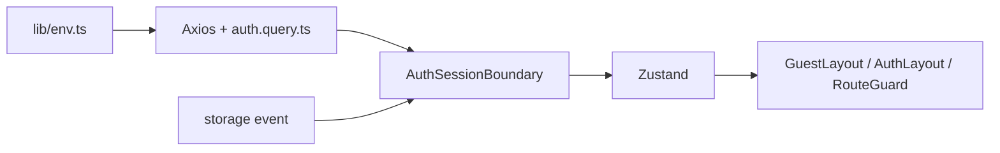

# Session handling

The router mounts one `AuthSessionBoundary` inside QueryClientProvider. Zustand holds the verified user and access status. The access token is stored in localStorage under `faculty-eval:access-token` and read when each protected request starts. React Query handles fetching, errors, freshness, cancellation and mutation scheduling. The application and Axios share the QueryClient in `src/lib/query-client.ts`.

The cached Faculty Evaluation API 1.2.0 contract defines login as `{ message, accessToken, user }`, refresh as `{ message, accessToken }`, `/user/me` as the user directly, and logout as `{ message }`. The API user has an encrypted string `id`, nullable email, status, `userInfo`, nullable faculty/student identities, a nested effective `access` tree, parallel flat `roles` rows, and group memberships. Keep the client ID type as string; a supplied sample with a numeric ID conflicts with the published contract and is not enough to change it. API role/scope codes remain open strings, but unknown roles do not grant named application policies. Documented staff role examples include `REGISTRAR`, `ENROLLMENT_OFFICER`, and `ACCOUNTING`; role codes remain backend-managed.

The `access` tree groups module grants by campus, role, and nullable college. A null campus or college means the assignment is unrestricted at that boundary. Module rows carry their direct/group origin, limited flag, expiry, and optional group. The nested tree is the effective permission source; flat roles and memberships preserve row provenance and identity data. `SUPER_ADMIN` must explicitly match the required roles, campus, and college on the same nested assignment. `ALL` remains the effective module marker for `SUPER_ADMIN`; it does not grant other roles unrestricted module access. The API scope list has no `GLOBAL_ACCESS` code. Grant expiry is taken from the server-refreshed effective profile; the browser does not interpret unzoned expiry timestamps.



## Configuration

| Variable                | Default | Purpose                                                                           |
| ----------------------- | ------- | --------------------------------------------------------------------------------- |
| VITE_API_BASE_URL       | /api    | API base; local .env.example uses http://localhost:3000/api. Services append /v1. |
| VITE_API_TIMEOUT_MS     | 15000   | Positive request timeout in milliseconds.                                         |
| VITE_AUTH_STALE_TIME_MS | 300000  | Non-negative query freshness, not cookie/token lifetime.                          |
| VITE_AUTH_SYNC_TABS     | true    | Enable explicit tab publishing/listening; accepts true or false.                  |

`src/lib/env.ts` parses these public build-time settings once. Invalid supplied values identify the setting in a startup validation error. Update `.env` and restart Vite when changing configuration.

## Ownership

- `auth.store.ts` holds user, status, isAuthenticated, logoutCause and one version for obsolete HTTP responses. Tokens are not duplicated in the store. It does not duplicate request errors.
- `auth.query.ts` exposes mutation hooks with internal settings and one native scope. Login persists the access token and authenticated flag; the Login page reloads after success. The login response user is not applied to the verified session. Logout clears the session. Explicit refresh replaces the token and resets the current-user query so the profile is fetched after the mutation settles. The current-user query requires the stored authenticated flag, as well as its enabled flag, and waits for auth mutations. It refreshes on window focus while enabled, without 60-second polling. The flag only allows verification; it never grants authenticated access. `authKeys.me()` contains only the verified user profile, or null for a confirmed signed-out session; access tokens are not put in this query cache.
- `auth.session.ts` holds shared cache/store updates, localStorage token helpers and the tab marker helpers. Logout and confirmed expiration remove both the token and authenticated flag. There is no custom event bus, mutation counter, fetch scheduler or remote-generation state. Account queries are removed on logout/account change; pending mutations remain managed by TanStack so queued actions can finish. Mutation records follow native garbage collection rather than manual cache traversal.
- `AuthSessionBoundary.tsx` observes `useCurrentUserQuery` on both guest and protected routes, waits for native auth mutation state, and owns the session-change storage listener. Without the authenticated flag it clears the local session instead of fetching. It never rebroadcasts received changes. Startup, Retry and incoming tab changes verify the current user. Shared storage subscriptions also detect authenticated-flag removal and storage clearing.
- `use-session.ts` exposes the Zustand state and current-user refetch for Retry, using the application QueryClient directly. No retry context/provider is needed.
- `axios.ts` attaches the current Bearer token to protected requests and sends credentials for the HttpOnly refresh cookie. On a protected 401, or a 403 with the exact message `Invalid or expired token.`, it shares one token-only refresh per session version, persists the refreshed token and replays each request at most once with the new Authorization header. It rejects obsolete responses and tokens. Login/refresh/logout do not recursively trigger refresh or receive a Bearer header.
- Layouts own redirects and access gating. Login/Sidebar submit their mutations and handle caller errors. AuthLayout remounts protected page state when the user ID changes.

## Behavior

AuthLayout shows Loading while restoring/reconciling the session. Temporary verification/refresh failures retain the known user behind Retry; protected children stay blocked until verification finishes. Confirmed session rejection signs out; ordinary endpoint 403 responses remain permission failures. The exact invalid/expired-token 403 is treated as an authentication failure, refreshed once and signed out if authentication is still rejected.

Startup reads `faculty-eval:authenticated` from localStorage. When it is exactly `true`, the boundary fetches `/v1/user/me`, including on the login route. GuestLayout shows Loading or Retry during verification and redirects only after the server supplies a verified user. Successful login writes the access token to `faculty-eval:access-token`, writes `true` to the separate authenticated key and reloads the page, preserving the login URL and its return destination. Logout or confirmed expiration removes both keys independently of the tab-sync setting. Missing, invalid or inaccessible storage resolves signed out without calling ME or refresh. Login surfaces a storage failure rather than reloading without its required token/flag. User profiles and access assignments are never persisted in localStorage; server verification remains required. Previous `reservations:*` keys are no longer read; existing sessions using those keys require signing in again.

GuestLayout accepts a validated internal return URL. ADMIN/SUPER_ADMIN accounts with `EVALUATION` default to `/academic/evaluation/evaluation-reports`; faculty accounts without an administrator role and with `GRADES` default to `/academic/grade-encoding`; student-only accounts default to `/professors` when they have `EVALUATION`, or `/enrollment` when they have only `ENROLLMENT`. All authenticated accounts use AuthLayout. Student evaluation pages remain guarded by their student role and required scope, including for accounts that also have staff roles. Accounts without access to a mapped landing page default to `/profile`; unknown role codes do not grant staff feature access. The authenticated index `/` uses the same role and module requirements, and the retired Dashboard page is removed. Expiration preserves pathname, search and hash. Explicit logout goes to `/login` without a return URL; the consumed cause is cleared there so a later protected visit captures a new destination.

Other tabs receive only a unique ID and reason via `faculty-eval:session-change`, clear their old verified user and verify with the shared stored access token when the flag remains present. The receiving tab preserves the new token written by the signing-in tab. A received logout/expiration without a flag clears the local session without verification. No user data or credentials are stored in the marker. Tab changes reset the query, including while auth mutations temporarily disable it; native query scheduling verifies the final session after those actions settle. Window focus triggers current-user refetching while the query is enabled. A cold visit with the flag calls ME first using the persisted token; a 401 may then trigger the existing Axios refresh/replay flow. Existing flag-only sessions can also recover through this refresh flow. The boundary never proactively refreshes. Back to Login on the session error screen clears the local session so the guest form becomes available; Retry retains the flag and verifies again.

The verified profile is refreshed when the window regains focus while the query is enabled; there is no 60-second polling. There is no exact-expiry timer or cross-tab refresh lock. Cancellation cannot undo cookie writes already performed by the server. Tests simulate storage/focus/reconnect and mock services/adapters; live two-tab browser checks remain necessary to validate actual event/cookie behavior.

## Profile and password

The AuthLayout account menu opens `/profile`, which displays the verified `/v1/user/me` user already owned by the session boundary. Profile is hidden from the module sidebar. `/profile/change-password` opens the password modal over that page; Cancel returns to Profile. Student routes use the same sidebar, account menu, and command menu as other authenticated routes, with page access controlled by route roles and scopes.

`POST /v1/auth/change-password` sends only `current_password` and `new_password`. The new password requires at least eight characters; confirmation is checked locally and password whitespace is preserved. The handler follows confirmation, safeMutate, failure/success toast and close navigation. The documented operation signs out other devices; the frontend preserves the current session and refreshes only `authKeys.me()` on success. Its mutation key is separate from session-changing auth mutations so Axios sends the Bearer token instead of cancelling the request. Mutation records use `gcTime: 0` to discard password variables after the modal unmounts. Passwords are never persisted to localStorage or profile query data.

An active account with `must_change_password` can reach the first-login password screen even when it has no access assignments. The first-login mutation sends `new_password` and `confirm_password`, refreshes the verified profile on success, and ends the current session on a confirmed token rejection only if the session version still matches. The API documents a 15-minute first-login window but does not identify its rejection code/message. Other 403 responses remain form errors and offer an explicit Sign in again action; the browser does not guess window expiry or run its own expiry timer.

## Access checks

`useCanAccess` and `CanAccess` reuse the current verified Zustand user without fetching a separate profile. Both deny while checking, signed out or in a session error. All users, including `SUPER_ADMIN`, must match the feature route's role restrictions and module:

| Feature | Roles | Module |
| --- | --- | --- |
| Users | SUPER_ADMIN | USERS |
| User Groups | SUPER_ADMIN | USERS |
| Audit Logs | SUPER_ADMIN | AUDIT |
| Windows Config | ADMIN or SUPER_ADMIN | WINDOWS |
| Employees | ADMIN or SUPER_ADMIN | FACULTY |
| Students | ADMIN or SUPER_ADMIN | STUDENTS |
| Classes | ADMIN or SUPER_ADMIN | CLASSES |
| Evaluation Reports | ADMIN or SUPER_ADMIN | EVALUATION |
| Faculty grade encoding | FACULTY | GRADES |
| Grade monitoring | ADMIN or SUPER_ADMIN | GRADES |
| Student evaluation submission | STUDENT | EVALUATION |
| My Enrollment | STUDENT or SUPER_ADMIN | ENROLLMENT |

Sidebar visibility uses the same route requirements. Route access or module denial renders `ForbiddenState` by default, as does a custom guard returning `false`. A configured `unauthorizedElement` overrides that fallback. Guard string results still perform intentional redirects. Application role and scope codes live in `src/features/shared/access/users-access.config.ts`.

```tsx
import { USER_ROLES } from '#/features/shared/access/users-access.config'

const { canAccess, checkAccess } = useCanAccess({ roles: [USER_ROLES.SUPERADMIN] })
const canManage = checkAccess({ roles: [USER_ROLES.ADMIN] })

<CanAccess roles={[USER_ROLES.SUPERADMIN]} fallback={null}>
  <RestrictedAction />
</CanAccess>
```

Import the hook/types from `#/hooks` and the component from `#/components`. `checkAccess` evaluates its own complete requirement; it does not merge the hook's original options. Omitted requirements allow an active authenticated user. Empty arrays and blank strings deny. Arrays mean any matching role/module; different fields combine with AND.

Role, module, campus, and college requirements must match the same nested access assignment. A null campus/college is unrestricted at that boundary; module checks require an exact code or `ALL` on a matching `SUPER_ADMIN` assignment. Requirements that omit a module still check only their specified fields; the feature routes listed above require a matching module as well as a role. Expired grants are refreshed from `/user/me`; local interpretation is intentionally avoided because the API has not specified a timezone for unzoned `expires_at` values. There is no building requirement or other role-hierarchy privilege.

These utilities control client rendering and navigation. Backend endpoint role and ownership checks remain authoritative; UI checks do not replace them. No admission-status rules or ADMIN/SUPER_ADMIN aliases are used.

Direct-access editing uses flat `roles` rows with source `direct`, excluding module-owned FACULTY/STUDENT grants. Grantable role and compatible module options come from the API. The editor preserves nullable campus/college restrictions and raw expiration timestamps; group-derived rows remain read-only in the effective-access display. Saving replaces only direct grantable assignments and refreshes management queries plus the signed-in profile. An unrecognized role does not grant access to any staff feature.
